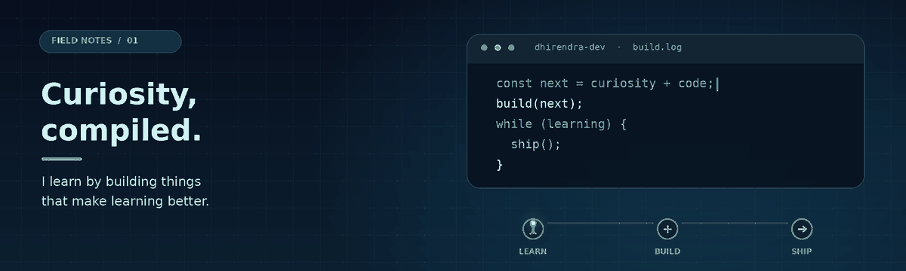

<h1 align="center">Dhirendra Kumar</h1>

<strong>Student · Developer · Builder</strong>

Building JEE Prep Hub — a focused study platform for JEE learners.

  

  
  

---

### About

I’m a student developer building JEE Prep Hub for students preparing for JEE. My focus is bringing study resources, practice, planning, and progress into one useful platform.

### Technologies

  
  
  
  

### My project

**[JEE Prep Hub](https://jeeprephub.co.in)** — A study platform for JEE learners, bringing resources, practice, planning, and progress tools together.

### GitHub activity

  
  

  

### Contribution activity

  

Learning by building. Improving JEE Prep Hub one step at a time.

